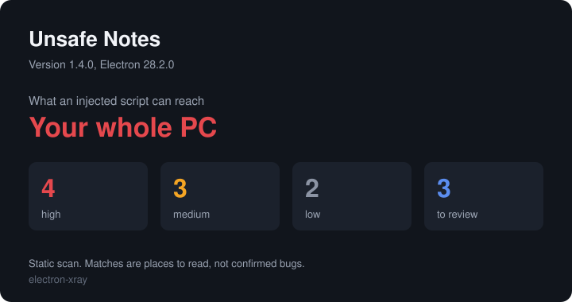
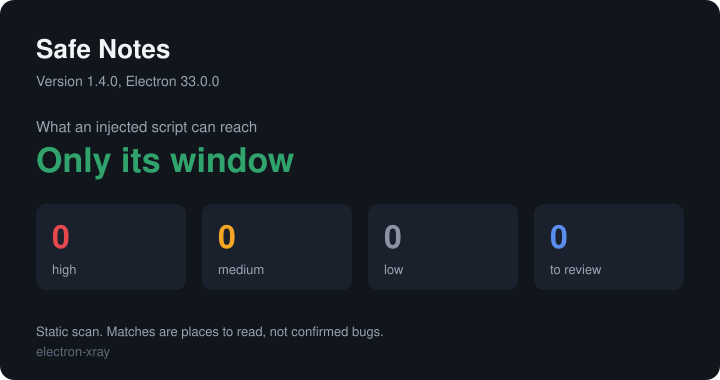

<div align="center">

# electron-xray

**Check any Electron app for the holes that let a bad web page take over your PC.**

Slack, Discord, VS Code and thousands of smaller desktop apps are Electron. One setting decides whether a script injected into the app stays in its window or gets your whole machine, and the app's files say which. This reads them, using the 14-layer checklist from [xss-audit](https://github.com/songjianyang/xss-audit) and the rebuild-any-app habit of [BAMA](https://github.com/daveebbelaar/bama).

Works with **Claude Code** and **Codex**.

  



<sub>Real output, from the deliberately unsafe app in <a href="examples/unsafe-notes">examples/unsafe-notes</a>.</sub>

</div>

## Quick start

```bash
git clone https://github.com/Dodai0419/electron-xray && cd electron-xray
python electron_xray.py --demo
```

```text
Unsafe Notes 1.4.0  Electron 28.2.0  (4 files read)

Can a bad web page reach your PC?
  YES. A script injected into this app gets your whole PC.

high 4   medium 3   low 2   to review 3

HIGH   A window can use Node.js directly
       main.js:12
       Any script that lands in this window can run programs and read your files.
```

Then point it at something real. There is nothing to install beyond Python 3.9 or newer.

```bash
python electron_xray.py list
python electron_xray.py audit "C:/Users/you/AppData/Local/Programs/SomeApp"
```

### Install in Claude Code

```bash
/plugin marketplace add Dodai0419/electron-xray
/plugin install electron-xray@electron-xray
```

Then ask: *"Is the Electron app I just installed safe to log in to?"*

### Install in Codex

```bash
git clone https://github.com/Dodai0419/electron-xray && cp -r electron-xray/skills/* ~/.codex/skills/
```

Or copy `AGENTS.md` to your project root.

## The problem

- You install desktop apps on trust. Whether a link in a chat message could run a program on your PC depends on settings you never see.
- Web scanners stop at the browser. In Electron, an ordinary XSS bug can become code execution on your machine, and only the app's settings tell you which.
- Your agent can read one file at a time, but an installed app is a packed `app.asar` plus a binary with settings burned into it.

## The solution

| Idea | Fixes |
|------|-------|
| **Reads the installed app** | Handles `app.asar`, unpacked files, `.app` bundles and plain source folders, with no build or source access |
| **One answer first** | "Can a bad web page reach your PC?" comes before any list |
| **Reads fuses from the binary** | `RunAsNode`, `NODE_OPTIONS` and `--inspect` are burned into the program and cannot be seen in the code |
| **14 layers of XSS sinks** | Every family in xss-audit's checklist has patterns, so your agent starts with a list of places to read |
| **Never claims too much** | A pattern match is reported as a place to read. Only clear settings are called findings |

## What the answer means

| Answer | What it means | What sets it |
|---|---|---|
| **Your whole PC** | A script in the window can run programs and read your files | `nodeIntegration` on |
| **Past the page** | A script can call the app's internals, which may or may not reach further | `contextIsolation` off, the remote module, or a preload that hands over raw IPC |
| **Only its window** | Nothing in this scan lets a script out of the page | None of the above |

The same app with its holes closed, from [`examples/safe-notes`](examples/safe-notes):



## What it checks

**Electron settings and code**

| Check | Severity |
|---|---|
| `nodeIntegration`, in windows, sub-frames or workers | High |
| `contextIsolation: false` | High |
| `webSecurity: false`, `allowRunningInsecureContent` | High |
| The remote module | High |
| A preload that exposes raw `ipcRenderer` | High |
| `loadURL("http://...")` | High |
| `<webview nodeintegration>` | High |
| `sandbox: false` | Medium |
| A variable URL reaching `shell.openExternal` with no scheme check | Medium |
| `bypassCSP`, experimental browser features, `<webview allowpopups>` | Medium |
| No CSP, or a CSP with `unsafe-inline` or `unsafe-eval` | Medium |
| Keys in the app's files (AWS, GitHub, Slack, Anthropic, OpenAI, Google, Stripe, private keys). Values are masked in all output | Medium |
| No navigation guard, no permission handler | Low |

**Fuses, read from the program file**

| Fuse | Problem when | Severity |
|---|---|---|
| `RunAsNode` | On | Medium |
| `EnableNodeOptionsEnvironmentVariable` | On | Medium |
| `EnableNodeCliInspectArguments` | On | Medium |
| `EnableEmbeddedAsarIntegrityValidation` | Off | Low |
| `OnlyLoadAppFromAsar` | Off | Low |

**14 layers of XSS sinks, from xss-audit**

| Layer | Examples |
|---|---|
| 1. DOM and HTML | `innerHTML`, `insertAdjacentHTML`, `document.write`, `DOMParser`, `setHTMLUnsafe`, `dangerouslySetInnerHTML` |
| 2. Attributes and handlers | `setAttribute("onclick", v)`, `srcdoc`, `formaction` |
| 3. URLs and navigation | `window.open(v)`, `location = v`, weak checks like `url.includes("trusted.com")` |
| 4. JSON in script | `JSON.stringify` inside a `<script>` block |
| 5. Props spreading | `<a {...props}>`, `<iframe {...rest}>` |
| 6. Sources and messaging | `message` listeners with no origin check, `postMessage(v, "*")`, `location.hash`, `document.referrer` |
| 7. Prototype pollution | `__proto__`, `_.merge`, `$.extend(true, ...)` |
| 8. JavaScript execution | `eval`, `new Function`, string timers, `executeJavaScript`, blob workers |
| 9. CSS | `cssText = v`, `insertRule(v)` |
| 10. SVG, MathML and XML | `createElementNS`, `xlink:href`, `foreignObject` |
| 11. Markdown and sanitizers | `marked(v)`, `html: true`, loosened DOMPurify options |
| 12. Framework hooks | `v-html`, `bypassSecurityTrust*`, `{@html}`, `unsafeHTML` |
| 13. Trusted Types | A policy that returns its input unchanged |
| 14. Template injection | `ng-bind-html`, `$compile`, `Handlebars.compile(v)`, `x-html` |

Plain strings are left out, so `el.innerHTML = ""` stays quiet, and so does code on a commented-out line. `node_modules` and well-known libraries are skipped unless you pass `--vendor`, and the report counts what it skipped. If an app has Node.js in its windows, layers 1 and 8 are raised to high.

## Commands

| Command | What it does |
|---|---|
| `audit TARGET` | Finds the holes. `TARGET` is an app folder, program, `app.asar`, `.app` bundle or source folder |
| `map TARGET` | Lists pages, windows, IPC channels, menus, link protocols, native modules and dependencies |
| `extract TARGET -o DIR` | Unpacks `app.asar`. Paths that would land outside the folder are refused |
| `list` | Finds Electron apps in the usual install folders. Add `--root DIR` to search elsewhere |

Options for `audit`:

| Option | What it does |
|---|---|
| `--report FILE.md` | Writes the full report with every place to read |
| `--card FILE.svg` | Writes the share card |
| `--json` | Machine-readable output for your agent |
| `--all` | Prints the places to read in the terminal too |
| `--vendor` | Also reads `node_modules` and bundled libraries |
| `--fail-on high` | Exits `1` when a finding is at least that bad, for CI |

Exit codes: `0` success, `1` `--fail-on` was triggered, `2` refused or bad input.

## Map an app before you rebuild it

BAMA's clone step walks through an app by hand and writes a screen index. `map` gives your agent the part that screenshots cannot show.

```bash
python electron_xray.py map examples/unsafe-notes
```

```text
Unsafe Notes 1.4.0  main: main.js  Electron 28.2.0

Pages (1)
  index.html

IPC channels (2)
  notes:load
  notes:save

Menus and labels (5)
  File
  New Note
  Export as PDF
  Help
  Check for Updates

Link protocols (1)
  unsafe-notes

Windows (1)
  width=1100, height=720, title=Unsafe Notes, file=main.js
```

Rebuild your own version of the idea. Do not copy another company's code, and check the app's terms first.

## Reports

`--report` follows xss-audit's format: audited paths, exclusions, summary, findings by severity, places that need manual review, and a per-layer summary that keeps matches apart from confirmed bugs. See [the sample](docs/sample-report.md).

A report can contain paths and code from the app. Read it before you share it.

## What it does not do

- **It never runs the app.** Nothing here proves that a bug can be exploited. A high finding means a dangerous setting is in the files, and it could sit in a window that only ever shows the app's own pages.
- **It does not know remote code.** Apps that load their interface from a website keep that code on the server, out of reach.
- **It has no CVE database.** It prints the Electron version when it can find one, but does not tell you whether that version is out of date.
- **Bundlers hide things.** Settings built from variables at run time will not match, so a clean result is not proof of safety.
- **Your agent has to finish the job.** xss-audit's method is to trace each sink back to its source. The skill tells the agent to do that, and this tool only finds where to start.

Only use it on apps you have installed or have permission to assess. It reads files and sends nothing anywhere.

## Why this instead of xss-audit or BAMA

| | xss-audit | BAMA | electron-xray |
|---|---|---|---|
| What it is | A skill your agent follows | 21 skills for building Mac apps | A program, plus a skill |
| Works on an installed app | No, it reads source | By driving the app's screens | Yes |
| Reads `app.asar` and fuses | No | No | Yes |
| Traces data flow by reasoning | Yes, it is the point | No | Left to your agent |
| Needs an agent to run | Yes | Yes | No |
| Same result each run | Depends on the agent | Depends on the agent | Yes |
| Rebuilds the app for you | No | Yes, as a native Mac app | No, it only maps it |

**Use xss-audit** for a careful review of your own web code, since its reasoning goes further. **Use BAMA** to actually build the clone. **Use this** to get a fast answer about an installed app, and to give your agent a list of places to start.

## Benchmarks

Windows 11, Python 3.11, laptop, best of 3. Run it yourself with `python bench/bench.py`.

| | xss-audit | electron-xray |
|---|---|---|
| Find sinks in a 4 MB bundle | not measured, depends on the agent | 8 to 13 s |
| Parse a 2,000-entry `app.asar` | no such feature | 5 to 15 ms |
| Audit the bundled example | not measured | 10 to 20 ms |
| Code | 322-line playbook, no program | 578 lines, one file |
| Dependencies | An agent | Python standard library |

Upstream is a skill with no program to run, so there is no speed to compare. On four real installed apps here, a full audit took 6 to 25 seconds, which is mostly the regular expressions reading large bundles. Their results are not published here, because a pattern match on someone's product is not a verified bug.

## Run the tests

```bash
python -m unittest -q
```

Tested on Windows 11 against real installed apps, and with made-up `.app` layouts and folders for macOS and Linux. It has not been run on a real Mac or Linux machine.

## Inspired by

- [songjianyang/xss-audit](https://github.com/songjianyang/xss-audit): the 14 layers, the rule that a match is not a confirmed bug, and the report format.
- [daveebbelaar/bama](https://github.com/daveebbelaar/bama): the idea that an agent should inventory an app before rebuilding it.

## Roadmap

- [ ] Compare two versions of an app and show what got worse.
- [ ] Warn when the Electron version is out of support, from a list you can update.
- [ ] Follow simple variables into `webPreferences`.

## License

MIT. See [NOTICE](NOTICE) for the projects this builds on.
